## Olá, eu sou o Victor 👋

**Desenvolvedor Full Stack** focado em aplicações web, integrações e sistemas orientados a dados.

Gosto de desenvolver soluções que simplificam processos reais — de plataformas web a integrações de pagamento e ferramentas de gestão.

<!--
  Links de contato: descomente a linha abaixo e troque pelos seus endereços reais.
  [LinkedIn](https://www.linkedin.com/in/SEU-USUARIO) · [E-mail](mailto:SEU-EMAIL) · [Portfólio](https://SEU-SITE)
-->

## Sobre mim

- Desenvolvo aplicações **Full Stack**, do banco de dados à interface.
- Trabalho com **APIs, webhooks e integrações**, incluindo pagamentos via PIX e Open Finance.
- Modelo e organizo dados com **PostgreSQL** e **Supabase**.
- Automatizo rotinas: tarefas agendadas, relatórios em PDF e conciliação de pagamentos.
- Gosto de transformar problemas operacionais em ferramentas úteis.

## Tecnologias

**Front-end**

**Back-end e dados**

**Integrações**

`APIs REST` `Webhooks` `PIX · Mercado Pago` `Open Finance · Pluggy`

**Ferramentas e infraestrutura**

## Projetos em destaque

> 🔒 Os repositórios destes projetos são privados. Descrevo aqui apenas o que já está implementado.

<table>
<tr>
<td>

### 💳 Payment Gateway

Gateway de pagamentos que orquestra provedores parceiros (PSPs) por trás de uma API própria: chaves de acesso com escopos, checkout PIX hospedado, dashboard do estabelecimento, webhooks assinados com retentativas, reembolsos e conciliação com o provedor.

**Problema:** oferecer cobranças por uma API única, com checkout e painel, enquanto o processamento e a liquidação ficam com instituições autorizadas.

**Stack:** `TypeScript` `NestJS` `Next.js` `PostgreSQL` `Prisma` `Redis` `Docker` `GitHub Actions`

**Status:** 🚧 Em desenvolvimento

</td>
</tr>
</table>

<table>
<tr>
<td>

### ⚽ Bolão Joga10

Plataforma web para gestão de bolões esportivos: cartelas, participantes, vendedores com comissão, ranking, relatórios em PDF e pagamento via PIX com confirmação automática por webhook. Também faz a leitura de cartelas em papel a partir de imagens.

**Problema:** organizar bolões com muitos participantes e vendedores, automatizando venda, pagamento e apuração dos resultados.

**Stack:** `Next.js` `TypeScript` `Supabase` `PostgreSQL` `Tailwind CSS` `Mercado Pago` `Resend`

**Status:** ✅ Ativo

</td>
</tr>
</table>

<table>
<tr>
<td>

### 📊 Controle Financeiro

Aplicação web para organizar finanças pessoais: receitas, despesas, contas fixas, carnês, cartões de crédito, metas, investimentos e relatórios com gráficos, com sincronização de contas bancárias via Open Finance.

**Problema:** ter uma visão única das finanças, juntando os lançamentos manuais e os dados que chegam direto dos bancos.

**Stack:** `JavaScript` `Firebase` `Chart.js` `Vercel Functions` `Pluggy`

**Status:** ✅ Ativo

</td>
</tr>
</table>

## Estatísticas

  
  

Cards gerados diariamente por GitHub Actions neste repositório. A maior parte do meu trabalho fica em repositórios privados.

  <picture>
    <source media="(prefers-color-scheme: dark)" srcset="https://raw.githubusercontent.com/victorbathich/victorbathich/output/github-snake-dark.svg" />
    <source media="(prefers-color-scheme: light)" srcset="https://raw.githubusercontent.com/victorbathich/victorbathich/output/github-snake.svg" />
    
  </picture>

## Contato

Quer falar sobre um projeto ou uma oportunidade? Me encontre por aqui:

- GitHub: [@victorbathich](https://github.com/victorbathich)
<!-- - LinkedIn: [linkedin.com/in/SEU-USUARIO](https://www.linkedin.com/in/SEU-USUARIO) -->
<!-- - E-mail: [SEU-EMAIL](mailto:SEU-EMAIL) -->
<!-- - Portfólio: [SEU-SITE](https://SEU-SITE) -->
